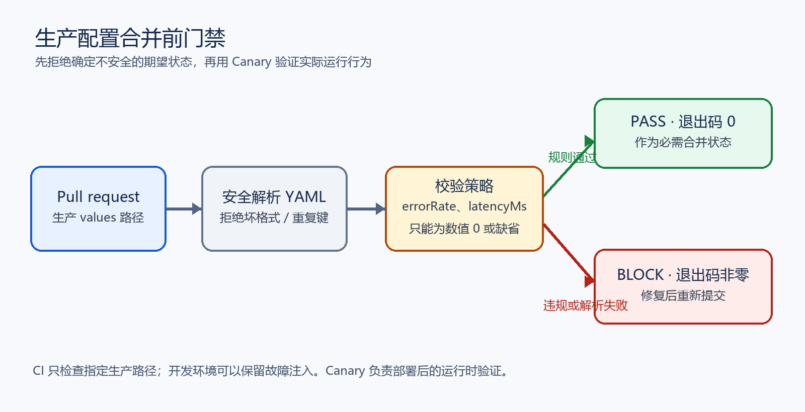

# 把生产故障配置挡在合并之前

## 学习目标

完成本章后，你可以：

1. 解释为什么 Canary 不能替代生产配置的合并前检查。
2. 为 YAML 配置定义明确、可审计的安全规则。
3. 让解析错误、重复键、类型不符和危险值都使流水线失败。
4. 用正例与反例验证门禁，并识别它的适用边界。

本章是一项独立工程实验。它取材于参考项目 P10 的开放练习，但代码、测试、教材和证据均在 temp-temp 中重新实现。我们只验证本地生产 values 样例；没有部署 Kubernetes，也没有访问 GitOps 集群。

## 1. 故障窗口在哪里

生产配置可以只改一个 YAML 文件，不改应用镜像，因此不会触发只针对应用镜像的端到端合成测试。若此时把 <code>faults.latencyMs: 800</code> 合并进生产环境，GitOps 控制器会忠实地把这个期望状态部署出去。Canary 分析可以在请求变慢后停止晋级，但故障配置已经进入集群，并且会继续留在 Git 中，等待有人回滚。

配置门禁把确定能静态判断的规则提前到合并请求阶段。它不会取代 Canary：静态规则挡住已知的不安全配置，Canary 检验真实运行行为。

## 2. 规则与拒绝条件

本实验只把 <code>envs/prod/values.yaml</code> 作为生产输入。规则如下：

- <code>faults.errorRate</code> 和 <code>faults.latencyMs</code> 缺省时安全；显式配置时必须是数值 0。
- 布尔值不是数字零；字符串 “0” 也不是数字零。策略避免 YAML/Python 类型转换掩盖错误。
- <code>faults</code> 存在时必须是映射；根文档也必须是映射。
- YAML 解析失败、文件不存在、重复键或无效 UTF-8 都失败关闭。
- 开发环境允许保留故障注入。安全边界由 CI 明确检查生产文件，而不是全仓禁止这些字段。

阻断结果使用退出码 1；输入或 YAML 解析错误使用退出码 2；通过返回 0。GitHub Actions 不会把失败误认为成功。

## 3. 实验结构

实验目录是 <code>labs/prod-config-guard/</code>：

- <code>guard.py</code>：策略实现及命令行入口。
- <code>envs/prod/values.yaml</code>：允许通过的生产样例。
- <code>envs/dev/values.yaml</code>：保留故障注入的开发样例。
- <code>fixtures/</code>：非零值、布尔值、重复键等反例。
- <code>tests/test_guard.py</code>：策略和进程退出码测试。
- <code>.github/workflows/lab-validation.yml</code>：所有分支推送、pull request 和手动运行的检查。

解析器使用 PyYAML 的 <code>SafeLoader</code>，不构造任意 Python 对象。自定义加载器另外拒绝重复映射键；否则多个工具可能对同一份 YAML 采用不同的“最后一个值胜出”解释。

## 4. 在隔离环境中复现

在仓库根目录打开 PowerShell。安装依赖并运行测试：

~~~powershell
python -m pip install -r labs/prod-config-guard/requirements.txt
python -m unittest discover -v -s labs/prod-config-guard/tests
~~~

检查当前生产配置：

~~~powershell
python labs/prod-config-guard/guard.py labs/prod-config-guard/envs/prod/values.yaml
~~~

预期输出：

~~~text
PASS: production fault injection is disabled or absent.
~~~

验证故障注入会被挡住：

~~~powershell
python labs/prod-config-guard/guard.py labs/prod-config-guard/fixtures/prod-bad-latency.yaml
~~~

预期退出码为 1，标准错误中包含：

~~~text
BLOCK: faults.latencyMs must be numeric 0 or be omitted (got 800)
~~~

检查重复键时，预期退出码为 2，错误说明 YAML 文件不能安全解析。开发样例保留非零故障注入；门禁对它也会拒绝，但 CI 只把生产 values 路径传入，正常开发配置因此不会进入这项生产门禁。

## 5. 为什么要失败关闭

### 5.1 类型和值是两条不同的检查

Python 中布尔类型是整数的子类型，所以简单写 <code>value == 0</code> 会错误地把 <code>False</code> 当成安全数值。字符串 “0” 也不能静默转换成数字，否则不同 YAML 消费端可能得出不一样的结果。本实现要求真实的 <code>int</code> 或 <code>float</code>，显式排除 <code>bool</code>，并拒绝 NaN 和无穷值。

### 5.2 重复键是解析器差异的来源

下面的配置容易被人误以为安全：

~~~yaml
faults:
  latencyMs: 0
  latencyMs: 800
~~~

不少解析器会保留后一个值；另一些严格解析器会报错。策略在门禁处把歧义本身视为失败，防止审查者、CI、模板渲染器和控制器各自解释不同。

### 5.3 缺失和空值不是一回事

没有 <code>faults</code> 表示没有启用故障注入。写成 <code>faults: null</code> 或 <code>faults: []</code> 则是结构错误，必须修正。这个区别能让错误的编辑在进入集群前被发现。

## 6. 门禁应该放在哪里

仓库工作流监听任何分支的 push 和 pull request。关键点是不要只用 <code>branches: [main]</code> 限制 pull request 的目标分支：堆叠分支或阶段分支同样要执行基础检查。仓库保护规则还必须把这个检查设为必需状态，否则工作流即使运行也不一定阻止合并。

工作流把 checkout 和 setup-python 两个 action 固定到完整提交 SHA，权限只给 <code>contents: read</code>。依赖也使用精确版本。固定 action 与依赖版本能减少版本漂移，但不能证明上游代码没有缺陷；仍要审阅升级差异并定期更新。

## 7. 验收证据与限制

实验验收需要同时看到：

| 条件 | 验证手段 |
|---|---|
| 数值零和缺省字段通过 | 单元测试、生产样例 CLI |
| 非零值被拦截 | CLI 退出码 1 与反例测试 |
| 布尔、字符串、重复键和坏 YAML 被拦截 | 加载器和策略测试 |
| 开发故障注入样例保留非零值 | 开发夹具检查其值，工作流只检查 prod 路径 |
| 分支范围不漏检 | 工作流触发器覆盖全部 push 与 pull request |
| PDF 可以阅读 | 生成 PDF，并渲染页面检查中文、配图与换页 |

本门禁只覆盖两个已知字段和指定生产 values 文件。它不会判断任意业务配置是否安全、不会校验 Helm 模板的最终渲染值，也不会证明应用在集群里健康。真实仓库应把它作为合并要求，使用同一版本的策略检查 Helm 渲染结果，并用 Canary、运行时指标与回滚演练验证部署行为。

## 本章小结

把确定性的配置不变量放进合并前门禁，可以缩短故障暴露窗口。门禁必须检查实际生产路径、拒绝解析歧义和类型混淆，并对所有分支运行。部署后仍需 Canary 和可观测性；它们回答的是不同问题。

## 练习

1. 把 <code>latencyMs</code> 改成字符串 “0”，观察 CLI 退出码，并解释为什么不能自动转换。
2. 把两个 <code>latencyMs</code> 键都设为 0，再把第二个改为 800。比较严格解析器与常见宽松解析器的风险。
3. 在生产配置中加入嵌套 YAML merge key。观察策略对重复键/合并覆盖的处理，再决定团队是否应禁止这类写法。
4. 为 <code>faults.cpuThrottle</code> 增加明确策略与测试。说明新增字段如何保持向后兼容。
5. 将检查接入一个真实 GitOps 仓库前，设计一项 Helm 渲染后检查，确保 values 合并和模板逻辑没有绕开源文件规则。
