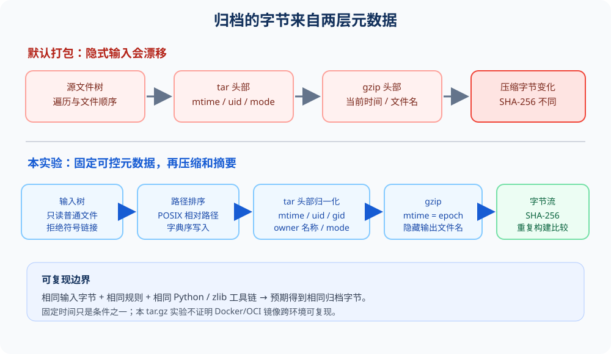

# 用 SOURCE_DATE_EPOCH 构建可重复归档

## 学习目标

完成本章后，你可以：

1. 分辨 tar 元数据与 gzip 头部中的时间来源。
2. 把文件顺序、归档属主、权限和时间戳变成显式输入。
3. 用重复构建的 SHA-256 证明归档字节是否一致。
4. 说明一个 tar.gz 实验能证明什么，以及不能证明什么。

参考项目记录过同一提交两次构建得到不同镜像 digest，并把固定 SOURCE_DATE_EPOCH 列为后续改进方向。本章把这个问题缩小成一个不需要 Docker 或集群的可验证实验：相同源文件，先用默认元数据打包，再逐层归一化 tar 与 gzip。代码、样例和输出均独立保存在本仓库。

## 1. 为什么同样的内容会得到不同摘要

SHA-256 对输入的每一个字节敏感。两个包解压后内容相同，也可能因为压缩文件中任一字节不同而产生完全不同的摘要。归档文件通常至少有两层：

- **tar 层**保存成员顺序、路径、mtime、uid、gid、用户名、组名、权限和内容。
- **gzip 层**包装压缩后的 tar 字节；头部可包含 mtime 和原始文件名，压缩器还会影响最终字节。

仅固定构建时间并不够。若 tar 成员顺序或 owner 字段继续来自主机，字节仍可能变化；若 tar 归一化但 gzip 头部写入当前时间，最终摘要也会变化。可重复构建要求把会进入输出的非内容变量都识别出来，并固定或移除它们。

## 2. 实验的归一化规则

P02 使用 Python 标准库，不下载依赖，也不需要容器。pack.py 对源树中的普通文件按 POSIX 相对路径排序，并拒绝符号链接和特殊文件。归档路径不包含本机绝对路径。

| 输入因素 | 朴素打包 | 本实验 |
|---|---|---|
| 文件顺序 | 由打包器默认遍历 | POSIX 相对路径排序 |
| tar mtime | 源文件 mtime | 固定 SOURCE_DATE_EPOCH |
| tar uid/gid 与名称 | 当前主机元数据 | uid/gid 为 0，名称为空 |
| tar mode | 原始权限位 | 可执行文件 0755，其余 0644 |
| gzip mtime | 默认使用当前时间 | 与 SOURCE_DATE_EPOCH 相同 |
| gzip 原始文件名 | 可能来自输出路径 | 空字符串 |
| 输出写入 | 直接写目标文件 | 临时文件完成后原子发布 |

SOURCE_DATE_EPOCH 是 Unix UTC 秒数。gzip 头部的 mtime 字段只有 32 位，因此此实现明确接受 0 至 4294967295，并拒绝区间外的值。这个限制是格式边界，不是时间规范的普遍限制。

归档器还要求输出文件位于源目录之外，默认拒绝覆盖已有文件；--force 才允许替换。读取期间若检测到文件身份、大小、mtime、类型或权限位变化，会失败，而不会声称得到稳定快照。它不锁定源目录；需要对抗并发写入时，应从只读快照或不可变构建目录打包。

## 3. 在 Windows 或 Linux 上复现

要求 Python 3.10 或更新版本。本实验使用 Python 3.13.9。进入仓库根目录，先运行回归测试和完整对照实验：

~~~powershell
python -B -m unittest discover -v -s labs/reproducible-archive/tests
python -B labs/reproducible-archive/reproduce.py
~~~

对照脚本会将样例复制到系统临时目录，不修改仓库中的输入。它先打包两次朴素归档，再改变临时文件的 mtime；随后用同一个 epoch 构建两次归一化归档；最后改变文件内容并再次构建。

预期观察：

- 朴素归档的两个 SHA-256 不同。
- 归一化归档的两个 SHA-256 相同。
- 改变文件内容后，归一化归档的 SHA-256 不同。
- 脚本末尾打印 PASS。

也可以直接构建一个归档：

~~~powershell
python labs/reproducible-archive/pack.py --source labs/reproducible-archive/sample/source --output $env:TEMP/sample.tar.gz --source-date-epoch 1700000000
Get-FileHash $env:TEMP/sample.tar.gz -Algorithm SHA256
~~~

输出路径必须不存在；若要有意替换已有结果，追加 --force。也可省去命令行 epoch，并在环境变量中设置 SOURCE_DATE_EPOCH=1700000000。无论哪种方式，未提供时间输入都会报错退出，不会偷偷读取当前时间。

## 4. 本地结果与流水线

本机 Windows 使用 Python 3.13.9。12 项测试中 10 项通过；2 项依赖宿主的集成测试按 Windows 平台跳过：文件系统不暴露 POSIX 执行位，符号链接创建也受权限策略影响。权限映射单元测试在本机通过；Linux GitHub Actions 会运行完整 12 项测试。

一次本地重放中，SOURCE_DATE_EPOCH=1700000000 的两个归一化包都得到 SHA-256：

~~~text
0e15bb81a0631b3f9343fc59a58636d251e47968515a68696714a87c309f2661
~~~

改变临时样例内容后得到：

~~~text
56a495c05cbf0af417d1bd9fabf0cfaa4a5651ae13e02c89a253bf4b35c771ce
~~~

朴素归档的摘要会随运行和主机时间变化；实验记录了其中一组实际值与完整命令。摘要不是预先指定的黄金值，重要的是同一受控输入的两次构建相等、内容变化后不相等。

GitHub Actions 中的 reproducible-archive job 只使用标准 ubuntu-24.04 hosted runner、Python 3.13 和仓库样例：运行测试并打包到 runner 临时目录。工作流没有向仓库提交生成的归档，也不使用外部服务或付费资源。

## 5. 如何判断结论的边界

本实验验证的是**同一 Python/zlib 工具链下，对固定文件字节执行 tar.gz 封装时，归一化元数据可以消除观察到的漂移**。它没有验证源码编译过程本身，也没有验证另一台操作系统或另一版本压缩器生成相同字节。

容器镜像 digest 由更多输入决定，例如基础镜像 digest、构建器版本、依赖解析结果、文件系统层顺序、镜像配置、环境变量和时间戳。锁定一个 SOURCE_DATE_EPOCH 不能自动控制这些因素。本章也没有运行 Docker build、BuildKit、OCI 导出、SBOM 或镜像签名。因此，不可把本实验写成“容器镜像已可复现”。

下一阶段 P03 会单独研究镜像供应链材料与消费方校验；任何镜像重建结论都需要在隔离构建环境中比较真实 OCI digest，并记录具体 builder、基础镜像和依赖输入。

## 6. 常见失败与排查

- **提示缺少 SOURCE_DATE_EPOCH**：这是预期的失败关闭行为。显式传入 --source-date-epoch，或在环境中设置变量。
- **第二次构建摘要不同**：确认 epoch 相同、源内容没变、输入树里没有符号链接；检查 Python 与 zlib 版本，再比较 tar 成员顺序和 gzip 头部时间。
- **Windows 宿主集成测试被跳过**：chmod 不暴露 POSIX 执行位，创建符号链接也可能受权限策略限制。Linux Actions 会运行归档权限和符号链接拒绝断言。
- **输出已存在**：检查路径后使用新文件名，或有意使用 --force。默认保护可避免实验覆盖先前证据。
- **出现 permission 或 hard-link 错误**：临时文件在目标目录创建，发布依赖同卷原子链接；换到可写且支持硬链接的本地目录再试。

## 参考资料

1. 参考项目本地只读副本，P10 闭环章节，构建可复现性条目：同一提交两次构建 digest 不同，建议固定构建时间输入。该文件在实验开始时已存在未提交修改；本实验只读取，没有写入。
2. [SOURCE_DATE_EPOCH 文档](https://reproducible-builds.org/docs/source-date-epoch/) 与 [SOURCE_DATE_EPOCH 规范](https://reproducible-builds.org/specs/source-date-epoch/)。
3. [Python 3.13 gzip 文档](https://docs.python.org/3.13/library/gzip.html)，包括 GzipFile 的 mtime 参数。
4. [Python 3.13 tarfile 文档](https://docs.python.org/3.13/library/tarfile.html)，包括 TarInfo 与 PAX 格式。

## 本章工件

- 独立归档器：labs/reproducible-archive/pack.py
- 对照实验：labs/reproducible-archive/reproduce.py
- 回归测试：labs/reproducible-archive/tests/test_pack.py
- 可重复构建实验记录：docs/experiments/2026-11-reproducible-archive.md
- 本地运行与 PDF 页面证据：evidence/p02/
